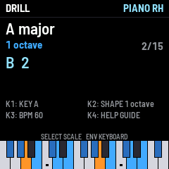
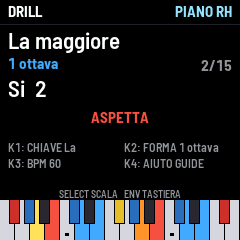
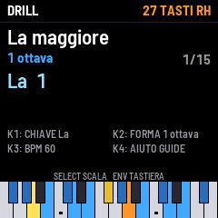
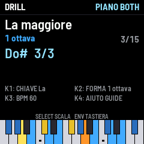

<p align="center"></p>

# SCALE DRILL for the M-VAVE FM-1

> **This is a fork.** It is [wave00066/THEORY-1](https://github.com/wave00066/theory1) with **one addition: SCALE
> DRILL**, a scale practice machine in the tenth row of LESSONS. Nothing else was changed. The fork also moves the
> `base/` submodule to the commit that accepts the UC25HQ80 flash of the newer units
> ([upstream PR #2](https://github.com/wave00066/theory1/pull/2)), without which nothing is saved on those.
>
> **Everything else in the firmware** - the theory lessons, the quiz, the lab, the SYNTH section, the five languages -
> is upstream's work, unchanged. If you want those, install the original firmware from
> [wave00066/THEORY-1](https://github.com/wave00066/theory1) and read its README; this page only describes the drill.

<p align="center">   </p>

## What it is

Pick a scale, a key, a shape and a tempo, and the FM-1 becomes a coach: the keys light up, you play on the FM-1's own
keys or on a piano over USB, TRS or Bluetooth, and every note is judged as it comes. The mechanisms are the ones the
paid practice software has proven - a wait mode, an automatic tempo ladder, a light guide that fades - rather than
anything invented here.

## How to play

1. **LESSONS** -> scroll to the tenth row, **DRILL** -> **SEL**.
2. The shape plays itself once, in a hurry (200 ms a note), naming each note and the finger to use it with: `B 2` is B
   with the second finger, and a red `TURN` is a thumb-under or a cross-over you are about to meet.
3. **Turn SELECT** for another scale, **K1** for another key - every turn plays the shape again, so the ear knows first.
4. **Press keys before you start.** Any key of the scale names its note, its finger and which note of the shape it is
   (`3/15`). Nothing is judged yet: this is how the fingering is learnt, and it is the point of the whole screen.
5. **PLAY** counts four beats in and starts. The next key is bright, the rest of the scale half-lit, the root in its own
   colour. A wrong note blinks red and the round waits there until you play the right one. **PLAY** again stops the
   round and puts the screen back where it started.
6. A clean round gains **8 BPM** and fades the help one level. Three wrong notes, or four uneven ones, give a level back
   and lose 8. A stumble on a turn keeps the tempo where it is and says so (`WATCH THE THUMB`).
7. Leave with **HOME**: the fastest clean round is kept per scale, key and shape.

| Control | What it does |
|---|---|
| **SELECT** | the scale (the skill): major, natural minor, harmonic minor, melodic minor, major pentatonic, minor pentatonic |
| **K1** / PRESETS | the key, round the circle of fifths |
| **K2** | the shape: one octave, two octaves, or two octaves up only |
| **K3** | the tempo in BPM - one note a beat, one click a note, 40 to 200 |
| **K4** | the help: GUIDE (note and finger), FRAME (finger only), ANCHOR (roots only), BLIND (nothing) |
| **ALGORITHM** | whose hand: `RH`, `LH`, and on a piano `BOTH` and `CONTR.` (contrary motion) |
| **ENV** | where your hands are: `PIANO` (your own keyboard) or `27 TASTI` (the FM-1's own keys) |
| **PLAY** | play and stop: counts in and starts, or stops the round where it is |

The four knobs' settings are on the screen, two columns: `K1: KEY A` `K2: SHAPE 1 octave`, `K3: BPM 60` `K4: HELP GUIDE`.

## Three things worth knowing

- **The 27 keys** get one octave, placed between two roots you can see (A major climbs A3 to A4, never off the right
  end), and the note itself is asked for. Asking for a longer shape switches to `PIANO`.
- **Both hands and contrary motion** are piano modes. One MIDI channel cannot say which hand played, so those two show
  the fingering and the two keys and judge only the right hand - the limit is written down in
  [`docs/DRILL.md`](docs/DRILL.md) rather than hidden.
- **Only scales with a published fingering are on offer** - the six above. A scale can be learnt without a fingering,
  but it cannot be practised without one, and this screen exists to practise: the blues scale (four sources, four
  right-hand patterns), the whole tone, the octatonic, the chromatic and the world scales stay in the lessons, where
  they are studied. The classical melodic minor comes down as the natural minor, as it should.

## Install

1. Get `theory1-X.Y.fwsc` from this repository's [Releases](https://github.com/hardass/theory1/releases).
2. Connect the FM-1 to a computer with a USB **data** cable, directly, without a hub.
3. From a terminal, in a copy of this repository (`git clone --recursive`):
   ```sh
   pip install mido python-rtmidi
   python3 base/tools/fm1_install.py theory1-X.Y.fwsc
   ```
4. Don't unplug the cable while it writes. The FM-1 restarts by itself when it is done.

**Back to the official firmware:** download `FM-1.fwsc` (V15) from M-VAVE's download page and install it with
M-UPGRADE, the Firmware Hub or `fm1_install.py`. If the firmware ever fails to start twice, the FM-1 comes up in
fm1-base's safe mode, from which any firmware can be installed again. This is unofficial firmware, not tested on every
unit: you install it at your own risk.

## Build

The JieLi toolchain and the AC79 SDK are needed for a package, and both are x86-64, so a Linux machine builds it
without CI:

```sh
sh base/tools/get_toolchain.sh                             # ~/.jieli/toolchain
sh base/bsp/tools/get_sdk.sh                               # ~/.jieli/ac79-sdk
cd ~/.jieli/ac79-sdk && git sparse-checkout add /apps/common/config/    # get_sdk.sh's set is short of these
cd <this repository>
JIELI_TOOLCHAIN=$HOME/.jieli/toolchain AC79_SDK=$HOME/.jieli/ac79-sdk ./build.sh --release 1.8.0
```

Checks, with no FM-1 and no compiler:

```sh
sh tests/run_tests.sh                                   # the theory, the drill, every quiz, every text in five languages
python3 base/tools/build.py app --host                  # the simulator
app/build/host/theory1_host app/tests/drill.txt app/build/test
```

## Layout

| File | What it holds |
|---|---|
| `app/drill_engine.{h,c}` | the drill's engine: the sequence and its fingering, the judging, the tempo ladder, a round's verdict. Plain C, tested on its own |
| `app/app.c` | the drill's screen, its lights, its store object, and the rest of upstream's screens |
| `app/texts.c` | every word on the screen, in five languages |
| `app/tests/drill_test.c`, `app/tests/drill.txt` | the engine's checks and the drill in the host simulator |
| `docs/DRILL.md` | the drill's design: controls, judgement, ladder, tests, and where it departs from its original specification |
| `base/` | [fm1-base](https://github.com/charlesvestal/fm1-base) with [felucca-bsp](https://github.com/hugelton/felucca-bsp), as submodules |

## Licence and credits

THEORY-1's code (which most of this is) is under the **Mozilla Public License 2.0** ([`LICENSE`](LICENSE)); the drill
is under the same. A firmware package (`.fwsc`) also contains:

| Part | By | Licence |
|---|---|---|
| [THEORY-1](https://github.com/wave00066/theory1) | wave00066 and contributors | MPL-2.0 |
| [fm1-base](https://github.com/charlesvestal/fm1-base) (`base/`) | Charles Vestal and contributors | MPL-2.0; a few files in `base/ble/` are `MPL-2.0 AND Apache-2.0` |
| [felucca-bsp](https://github.com/hugelton/felucca-bsp) (`base/bsp/`) | Leo Kuroshita (Hügelton Instruments) and contributors | MPL-2.0 (see `base/bsp/NOTICE`) |
| Barlow Semi Condensed, the screen's font | The Barlow Project Authors | SIL OFL 1.1 ([`LICENSES/OFL-1.1-Barlow.txt`](LICENSES/OFL-1.1-Barlow.txt)) |
| The clefs, notehead, sharp and flat (`app/staff_glyphs.h`), from Bravura | Steinberg Media Technologies GmbH | SIL OFL 1.1 ([`LICENSES/OFL-1.1-Bravura.txt`](LICENSES/OFL-1.1-Bravura.txt)) |
| JieLi AC79 SDK files and Bluetooth libraries, added at build time | Zhuhai Jieli Technology Co., Ltd. | Apache-2.0 ([`LICENSES/Apache-2.0.txt`](LICENSES/Apache-2.0.txt)) |

None of the JieLi files is in this repository: the build fetches them from the SDK.
